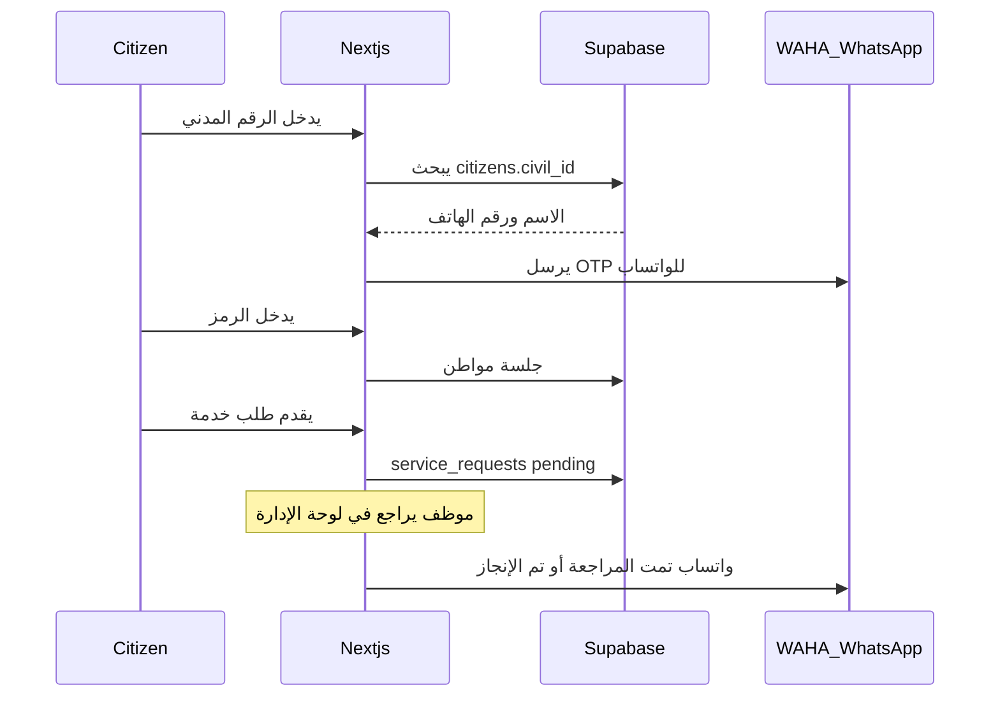

# بوابة مبنى خدمات شرطة عمان السلطانية

المجلد [`/Users/faisal/dev/rop`](/Users/faisal/dev/rop) فارغ. سنبني التطبيق من الصفر ونربطه بمشروع Supabase الموجود **ROP** (`tpsmltsvjuxmcfhilayy`، URL: `https://tpsmltsvjuxmcfhilayy.supabase.co`) وهو حالياً بلا جداول.

هذا نموذج تشغيلي لمبنى الخدمات (بيانات مواطنين تجريبية في قاعدة البيانات)، وليس ربطاً بنظام التصديق الإلكتروني الرسمي لـ rop.gov.om.

## الخدمات المعروضة (من موقع الشرطة الرسمي)

**مرور**
- تجديد رخصة السياقة
- إصدار رخصة سياقة جديدة
- تجديد سجل المركبة (الملكية)
- نقل سجل المركبة إلكترونياً
- دفع المخالفات المرورية
- طلب اللوحات التذكارية

**جوازات وأحوال مدنية**
- تجديد / إصدار البطاقة الشخصية
- تجديد / إصدار بطاقة المقيم
- تجديد / إصدار الجواز العماني
- استمارة التأشيرات وتجديد الإقامة

كل خدمة: صفحة شروط + نموذج طلب + رقم معاملة + تتبع الحالة.

## التدفقات

**مواطن:** الرقم المدني → إظهار آخر 4 أرقام من الهاتف المرتبط → OTP واتساب → كتالوج الخدمات → تقديم طلب → طلباتي.

**موظف:** دخول منفصل (بريد/كلمة مرور عبر Supabase Auth + دور `staff`) → قائمة الطلبات → مراجعة / إنجاز / رفض → إرسال واتساب تلقائي.

**ربط واتساب (local QR):** Docker لـ [WAHA](https://waha.devlike.pro) + صفحة إدارة `/admin/whatsapp` تعرض QR لمسحه من هاتف الإرسال. عند التنفيذ ستعطي رقم الواتساب الذي نربط الجلسة عليه. متغيرات البيئة: `WAHA_URL` و`WAHA_API_KEY`.

## التقنيات

- Next.js 15 App Router + TypeScript + Tailwind v4
- shadcn/ui (RTL عربي افتراضي، إنجليزي ثانوي عبر `dir`)
- `@supabase/ssr` + `@supabase/supabase-js`
- هوية بصرية مستوحاة من الشرطة: أحمر رسمي `#8B1538` / ذهبي / أبيض، شعار نصي «شرطة عمان السلطانية»، واجهة RTL واضحة (هوية حكومية بسيطة وليست نسخة حرفية من الموقع الرسمي)

## مخطط قاعدة البيانات (Supabase)

جداول في `public` مع RLS:

- `citizens` — `civil_id` (unique)، `full_name`، `phone` (E.164 مثل `9689…`)، `nationality`
- `profiles` — `user_id` → `auth.users`، `role` (`citizen` | `staff`)، `civil_id`
- `otp_challenges` — رمز مُجزّأ، انتهاء، محاولات؛ الكتابة عبر service role فقط من Route Handlers
- `services` — كتالوج ثابت (seed)
- `service_requests` — `citizen_id`، `service_id`، `payload` JSONB، `status` (`submitted` | `under_review` | `completed` | `rejected`)، `reference_no`
- `notifications` — سجل رسائل الواتساب (OTP / مراجعة / إنجاز)

سياسات RLS: المواطن يرى صفّه وطلباته فقط. الموظف (`app_metadata.role = staff`) يرى كل الطلبات. لا قرار صلاحيات من `user_metadata`.

تسجيل المواطن: Route Handler يتحقق من OTP ثم ينشئ/يسجّل مستخدم Supabase مرتبط بالرقم المدني (جلسة كوكي). الموظف: `signInWithPassword`.

بيانات تجريبية: عدة أرقام مدنية وهمية مرتبطة بهواتف للاختبار (ليست بيانات حقيقية).

## هيكل التطبيق

- `app/[locale]/` — `ar` افتراضي
- `app/[locale]/page.tsx` — الصفحة الرئيسية + الخدمات
- `app/[locale]/login` — الرقم المدني ثم OTP
- `app/[locale]/services/[slug]` — نموذج الخدمة
- `app/[locale]/requests` — طلبات المواطن
- `app/[locale]/admin` — لوحة الموظف
- `app/[locale]/admin/whatsapp` — حالة الجلسة وQR
- `app/api/otp/request` و `app/api/otp/verify`
- `app/api/requests/[id]/status` — تحديث الحالة + واتساب
- `lib/whatsapp.ts` — عميل WAHA (`sendText`)
- `docker-compose.yml` — خدمة WAHA محلية

نماذج الخدمات تجمع الحقول اللازمة فقط (مثلاً تجديد الملكية: رمز ورقم اللوحة؛ البطاقة: نوع الإصدار). بدون بوابة دفع حقيقية في هذه المرحلة (عرض الرسوم كمعلومة).

## ما تحتاجه عند التنفيذ

- رقم واتساب الإرسال لمسح QR في WAHA
- بريد/كلمة مرور لأول موظف (ننشئه في Auth ونضع `app_metadata.role = staff`)
- مفاتيح المشروع: `NEXT_PUBLIC_SUPABASE_URL` و publishable/anon من MCP `get_publishable_keys`

بعد البناء: التحقق في المتصفح لمسار المواطن (دخول + طلب) ومسار الموظف (مراجعة + إشعار).
